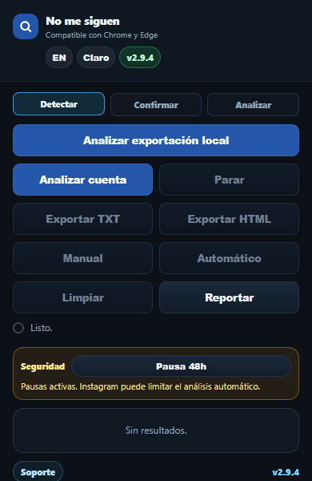
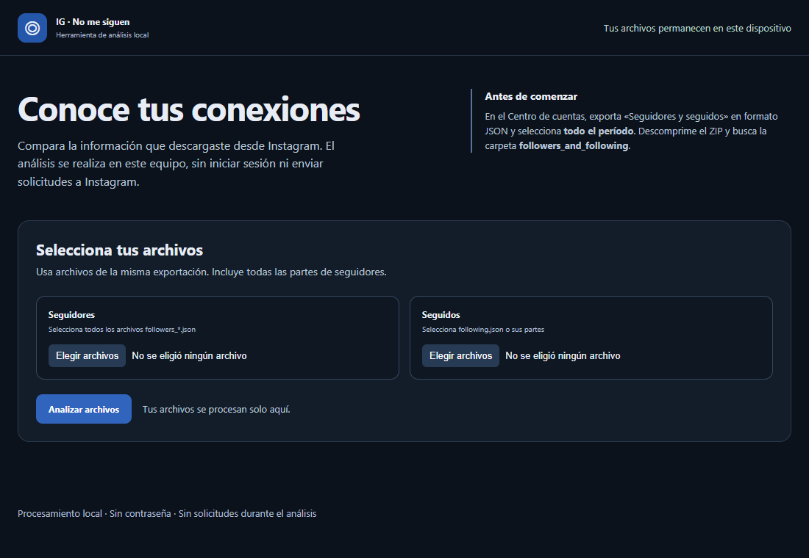

# IG · Quién no me sigue

Extensión para Chrome y Edge que ayuda a comparar conexiones de una cuenta de Instagram. El proyecto es independiente y no está afiliado con Instagram ni Meta.

## Cómo funciona

- **Análisis local:** compara los archivos JSON de seguidores y seguidos exportados desde el Centro de cuentas. Se procesan en el navegador y permiten generar un informe HTML.
- **Análisis en vivo:** utiliza la sesión iniciada en Instagram para consultar relaciones mediante interfaces internas no oficiales. Estas pueden cambiar o devolver datos incompletos; Instagram puede limitar las solicitudes.
- **Gestión manual:** abre perfiles para revisarlos. También existe una opción de dejar de seguir automáticamente, sujeta a restricciones y a las políticas de Instagram.

## Estado y límites

El arranque de la extensión y la pantalla se han comprobado en Edge con un perfil de prueba limpio. **El análisis en vivo no se ha verificado de extremo a extremo con una cuenta real en esta versión.** No hay demostraciones verificadas de relaciones de famosos; las capturas no representan resultados.

El análisis local es una instantánea de la fecha de exportación. Selecciona todas las partes de seguidores y seguidos de una misma exportación y el período completo; el programa no puede saber si faltan archivos. Las fotos pueden no estar incluidas.

La extensión se detiene ante señales de límite o verificación. Las pausas no garantizan evitar restricciones ni implican autorización de Instagram. Si Instagram solicita verificar la cuenta, completa la verificación en Instagram y espera antes de reintentar.

## Instalación para desarrollo

1. Descarga el código y descomprímelo.
2. Abre `edge://extensions` o `chrome://extensions` y activa el modo desarrollador.
3. Elige **Cargar descomprimida** y selecciona la carpeta que contiene `manifest.json`.
4. Tras modificar el manifiesto o el proceso de fondo, pulsa **Recargar** en la tarjeta de la extensión.

Para analizar una exportación, solicita en el Centro de cuentas de Instagram los datos de seguidores y seguidos en JSON, descomprime el ZIP y elige todos los archivos correspondientes en **Analizar exportación local**.

## Privacidad y permisos

No incluyas archivos de exportación, cookies, contraseñas, tokens, resultados personales ni capturas de cuentas en el repositorio. La extensión solicita permisos para cookies, almacenamiento, descargas, notificaciones, pestañas y alarmas; el modo en vivo usa la sesión local y comunica directamente con Instagram y sus dominios de imágenes. El análisis de archivos se realiza localmente.

La dirección `soporte@example.invalid` es un marcador de posición: configura un canal de soporte propio antes de distribuir el proyecto.

## Pruebas

Puedes comprobar la sintaxis con `node --check background.js`, `node --check popup.js` y `node --check local.js`. Estas comprobaciones no prueban que los servicios de Instagram sean compatibles.
